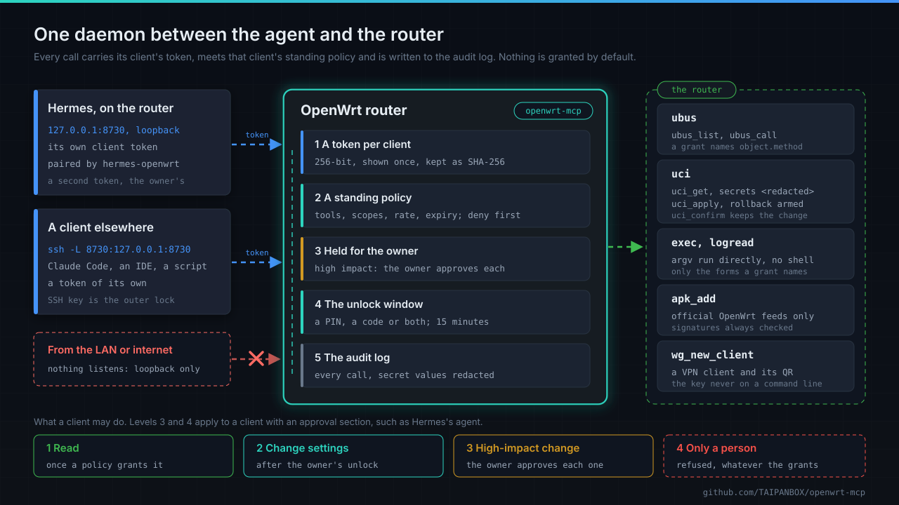
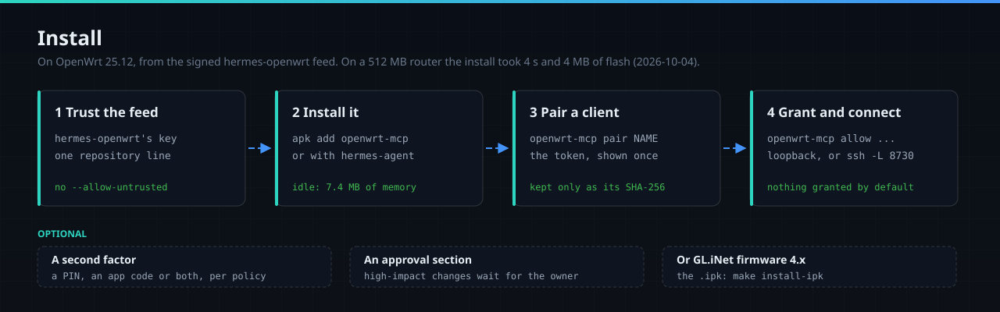
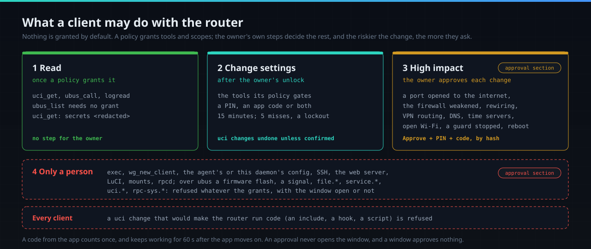
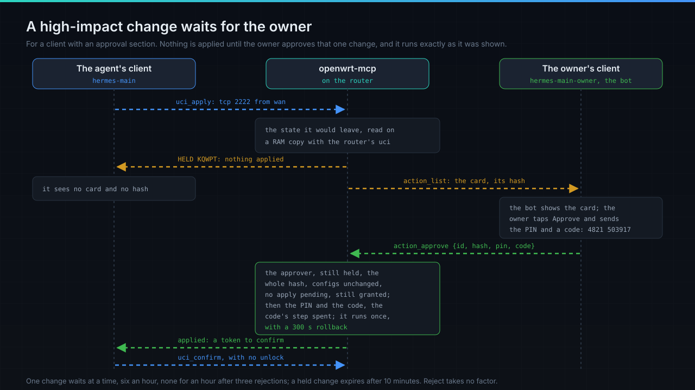
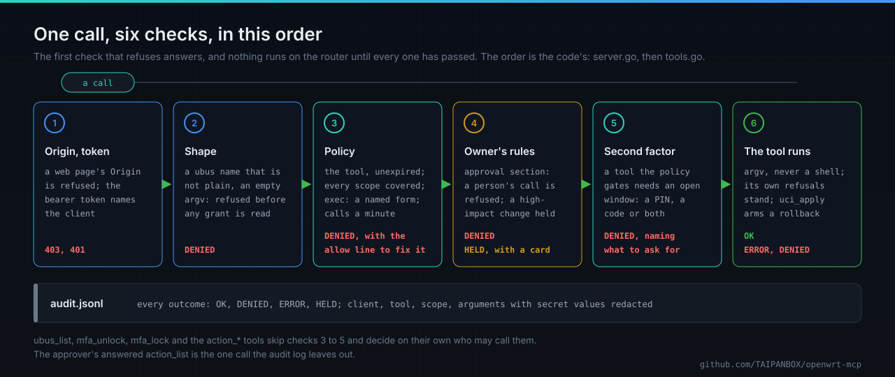
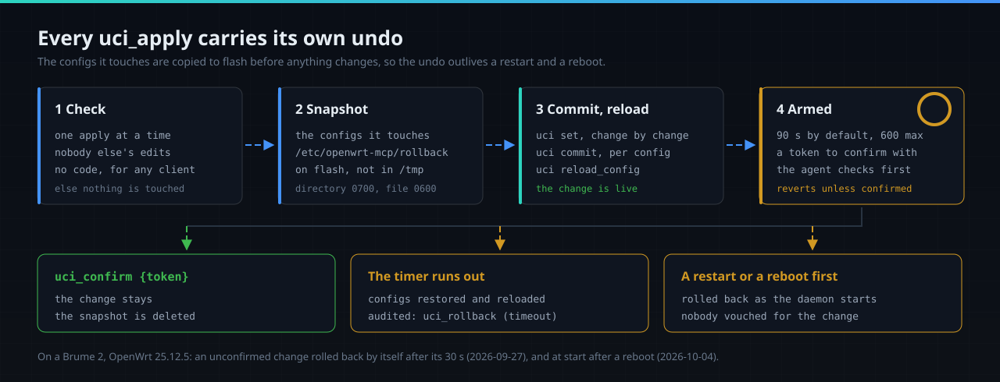

<div align="center">



# openwrt-mcp

An MCP server that runs **on** an OpenWrt router, so Hermes on the router, Claude Code or any MCP
client can read and change it: a token per client, standing policies, an audit log, and a rollback
on every configuration change.

[](https://github.com/TAIPANBOX/openwrt-mcp/actions/workflows/ci.yml)


[](LICENSE)

</div>



**Current release**, in the signed [hermes-openwrt](https://github.com/TAIPANBOX/hermes-openwrt)
feed since 2026-11-01: `openwrt-mcp` 0.5.0.7-r1 for OpenWrt 25.12 on `aarch64_cortex-a53` and
`aarch64_generic`, built with Go 1.27.3 from this fork's `main`. Every release is in
[CHANGELOG.md](CHANGELOG.md).

> This is the TAIPANBOX fork of **[GlassOnTin/openwrt-mcp](https://github.com/GlassOnTin/openwrt-mcp)**
> by **Ian Williams**, under the MIT licence. The resident daemon, its tools, the policy engine, the
> rollback, the TOTP second factor, the WireGuard tool and the GL.iNet status page come from the
> original project; this fork adds the owner's PIN and lockout, held changes, secret redaction,
> `apk_add` and the apk packaging. [Credits](#credits-and-licence).

## What it does

- **Reads the router for an agent.** `ubus list -v` already describes every object, method and
  argument on the router, so the agent finds what this router can do (the vendor's own `gl-*`
  objects included) through sixteen generic tools instead of a catalogue that goes stale with each
  firmware.
- **Changes it with an undo.** Every `uci_apply` arms a rollback timer: a change nobody confirms
  puts itself back, across a restart and a reboot too.
- **Asks the owner before the risky part.** Settings change after the owner's unlock, with a PIN, a
  code or both. For a client with an approval section, as Hermes's agent has, a high-impact change
  (a port open to the internet, the firewall weakened, VPN or DNS rerouted, a reboot) waits until
  the owner approves that one change.
- **Keeps secrets out of the agent's context.** `uci_get` answers `<redacted>` for every Wi-Fi key,
  password and private key, and the audit log never holds a secret's value.
- **Records what the agent did.** Every call it makes, allowed, refused or held, lands in the audit
  log, and a refusal prints the exact `allow` line that would cover it.

It runs on the router itself: one static Go binary under procd, always on, listening on loopback
only, with its own authorisation and audit trail. Idle, it holds 7.4 MB of memory.

## Install



You need OpenWrt 25.12 with apk on `aarch64`. The package comes from the hermes-openwrt feed. With
Hermes, follow [the hermes-openwrt Install](https://github.com/TAIPANBOX/hermes-openwrt#install)
instead: `apk add hermes-agent` installs this package and pairs Hermes's own client.

**1. Trust the feed and install.**

```sh
wget -O /etc/apk/keys/hermes-openwrt.pem \
  https://taipanbox.github.io/hermes-openwrt/hermes-openwrt.pem

echo "https://taipanbox.github.io/hermes-openwrt/25.12/$(cat /etc/apk/arch)/packages.adb" \
  >> /etc/apk/repositories.d/customfeeds.list

apk update && apk add openwrt-mcp
```

apk checks the feed's signed index against that key, so there is no `--allow-untrusted`. The
service starts at once and grants nothing.

**2. Pair a client and grant it something.** `pair` prints the token once; it is kept only as its
SHA-256 digest.

```sh
TOK=$(ssh root@192.168.1.1 'openwrt-mcp pair claude-code')
ssh root@192.168.1.1 "openwrt-mcp allow claude-code ubus_list,ubus_call,uci_get,logread 'network.* network.*.* iwinfo.* system.*' 30d"
```

Start narrow: a refusal names the scope it lacked and prints the `allow` line that would widen it.

**3. Connect.** The daemon listens on `127.0.0.1:8730` only, so a client elsewhere comes through
SSH:

```sh
ssh -N -f -L 8730:127.0.0.1:8730 root@192.168.1.1
claude mcp add --transport http openwrt http://127.0.0.1:8730/mcp \
  --header "Authorization: Bearer $TOK"
```

<details>
<summary>Upgrading, removing, GL.iNet firmware, a build of your own</summary>

```sh
apk update && apk upgrade openwrt-mcp     # restarts the daemon on the new binary
apk del openwrt-mcp                       # the policies in /etc/config/openwrt-mcp stay
```

GL.iNet firmware 4.x is OpenWrt 21.02 with `opkg`: build the `.ipk` on a workstation with Go 1.27
and `make install-ipk ROUTER=root@192.168.8.1`. The router needs no Go and no SDK. SSH keys, the
tunnel under systemd, the status page in GL.iNet's admin panel and how the packages are made:
[docs/install.md](docs/install.md).
</details>

## Letting an agent change the router



A grant decides which tools and scopes a client may use. Two more steps decide how far it goes:

- **The owner's unlock.** A policy lists the tools that need it (`mfa_tools`) and what it takes
  (`mfa_factor`: `totp`, `pin` or `pin+totp`). One unlock opens a window, 15 minutes by default;
  five misses lock unlocking for 15 minutes. A code counts once and works for 60 s after the app
  moves on.
- **The owner's approval.** A client with an approval section has its high-impact changes held:
  the daemon applies the change to a RAM copy of the configs with the router's own uci, compares the
  state it would leave, and keeps the exact call. Only the approver's client approves it, with the
  PIN and a code, against the hash of the card the owner was shown. It then runs once, with a 300 s
  rollback. What only a person may do (`exec`, a WireGuard key, the agent's own config, SSH, a
  firmware flash) is refused for such a client whatever its grants.

```sh
printf '%s\n' "$PIN" | openwrt-mcp pin set claude-code    # 4 to 8 digits, from stdin
openwrt-mcp mfa enrol claude-code --pending --qr           # scan the QR with an authenticator app
openwrt-mcp mfa activate claude-code 123456                # in force once a code proves the scan
openwrt-mcp mfa reset claude-code                          # clears the failed tries, root only
```

Five wrong tries in a row start a wait of 15 minutes, then 30, then an hour, and a restart or a
reboot forgives none of it: the disk holds the count and never a time. There is no overall cap, so
a lockout does not outlive the attack. `pin set` refuses the most common PINs.
[security.md](docs/security.md#guessing-costs-time-and-the-time-grows) has the scheme, the reasons
and the standard it departs from.

```
config policy
	option client      'claude-code'
	list   tools       'uci_apply'
	list   tools       'uci_confirm'
	list   scopes      'dhcp.*'
	list   mfa_tools   '*'
	option mfa_factor  'pin+totp'
```



hermes-openwrt sets all of this up for its agent: the owner chooses a PIN and a phone in LuCI and
approves from Telegram. Every rule, the held list, the card and the second factor in full:
[docs/security.md](docs/security.md).

## One call, check by check



The first check that refuses answers, and the tool's own code runs only once all of them have
passed. `pair`, `allow` and `unpair` are command-line only, so no tool can widen a grant.

## Scenarios

**A new router, read only.** Ask in plain language and let the agent find the objects:
*"What's on the 6 GHz radio right now, and how much airtime is each client using?"* The agent calls
`ubus_list` to see what is there (`iwinfo`, `network.wireless`, `luci-rpc`, `gl-clients`), then
`ubus_call` to read them. A read-only grant covers it and cannot change anything:

```sh
openwrt-mcp allow claude-code ubus_call,logread 'network.* network.*.* iwinfo.* luci-rpc.* gl-*.*' 30d
```

A `ubus_call` scope is an object and method pair: `network.*` names the object `network` only, and
`gl-*.*` names the `gl-*` objects ([tools.md](docs/tools.md#ubus_call-grants-are-object-and-method-pairs)).

**"The Wi-Fi keeps dropping out."** Association lists, scan data, DHCP lease churn and the system
log over the same window, correlated: tedious by hand, and well suited to an agent with the same
read-only grant. *"Cross-reference the last hour of logs against which clients disconnected, and
tell me whether it correlates with a channel change or a DFS event."*

**A configuration change with an undo nobody has to remember.**



```
uci_apply  {"changes": [{"config":"firewall","section":"@zone[1]","option":"input","value":"DROP"}],
            "timeout": 120}
  -> "ROLLBACK ARMED: reverts at 15:07:22Z (in 2m0s) unless you call uci_confirm {...}"
uci_confirm {"token": "3Kc681oIe4IP"}
  -> "Confirmed. Rollback cancelled."
```

A rule that locks the agent out repairs itself while it is still typing. A change with `type` and
no `option` creates a named section, so a static DHCP lease or a firewall rule goes in under one
rollback ([tools.md](docs/tools.md#uci_apply-changes-with-an-armed-rollback)).

**A trail of what the agent did.** `DENIED` is a different outcome from `ERROR`: "we said no" is
not "it broke".

```
OK      uci_apply    system.@system[0].description   applied 1 change(s), rollback armed 20s
OK      uci_rollback -                               rolled back system (timeout)
DENIED  uci_apply    system.@system[0].description   denied: no policy grants uci_apply to "confirm-test"
OK      uci_confirm  -                               confirmed m2_glAwWSd5L
```

**A package for the job.** `apk_add {"packages": ["tcpdump"], "dry_run": true}` lists what would be
installed and installs nothing; without `dry_run` it installs, from the official OpenWrt feeds only,
with signatures checked, and only names a policy grants
([tools.md](docs/tools.md#apk_add-installs-from-the-official-openwrt-feeds-only)).

**A VPN client for a phone.** `wg_new_client` issues a keypair and the next free tunnel address,
adds the peer without dropping live sessions, and returns the config with a QR to scan; the private
key never appears on a command line ([tools.md](docs/tools.md#wg_new_client)).

## Measured

On 2026-11-07 the suite ran 412 tests, 132 scenarios bound to them and to the package's checks, and
169 mutants of the approval code, the guess throttle and the folding of the audit log, each caught.
CI installs the `.apk` with OpenWrt's own apk in OpenWrt's 25.12.4
rootfs, `x86-64` and `aarch64_generic`, on every change. On a Flint 2 with OpenWrt 25.12.5 on
2026-10-22, a port forward from the agent waited as `HELD`, ran once after the owner's PIN and code,
and a second approval of the same card was refused. On a Brume 2, an unconfirmed change rolled back
by itself after 30 s and, after a reboot, as the daemon started. Every run, with its date and router:
[docs/measured.md](docs/measured.md).

## The OpenWrt family

Packages that run on the OpenWrt router itself, each from a signed apk feed for OpenWrt 25.12:

- [hermes-openwrt](https://github.com/TAIPANBOX/hermes-openwrt): Hermes Agent as a native OpenWrt
  service (apk, procd, UCI, no Docker), with a LuCI page and Telegram. It reads and changes the
  router through this daemon, and its feed is where `openwrt-mcp` is published.
- [openwrt-llm-gateway](https://github.com/TAIPANBOX/openwrt-llm-gateway): the house's model
  servers behind one name on the router, with a key per device.
- [rollcall](https://github.com/TAIPANBOX/rollcall): the routers of one site watch each other and
  report incidents through whichever of them is still online.
- openwrt-mcp, this repository: the router's own MCP server, with standing policies, the owner's
  unlock and held changes.

## More

| | |
|---|---|
| [docs/tools.md](docs/tools.md) | all sixteen tools, their scopes and rules, `uci_apply`'s rollback and its refusal to run code |
| [docs/security.md](docs/security.md) | the model, the second factor, held changes, secret redaction, the edges |
| [docs/install.md](docs/install.md) | SSH keys, building it, the tunnel under systemd, GL.iNet firmware and its status page |
| [docs/measured.md](docs/measured.md) | every run, with its date, router and figures |
| [CHANGELOG.md](CHANGELOG.md) | every release of the fork and of upstream |
| [CLAUDE.md](CLAUDE.md) · [features/](features) | the security invariants, their tests and gates, the scenarios |

## Credits and licence

openwrt-mcp was created by **Ian Williams** as
[GlassOnTin/openwrt-mcp](https://github.com/GlassOnTin/openwrt-mcp), and its security model is
adapted from [Haven](https://github.com/GlassOnTin/Haven), by the same author. This fork builds on
upstream 0.5.0: the owner's PIN and factor choice with growing delays, two-step QR enrolment, the
rollback snapshot kept on flash, secret redaction in `uci_get` and the audit log, `uci_apply`'s
refusal to run code, argument forms for `exec`, object and method pairs for `ubus_call`,
`apk_add`, held changes, and the `.apk` packaging, which was offered upstream in
[GlassOnTin/openwrt-mcp#1](https://github.com/GlassOnTin/openwrt-mcp/pull/1).

Copyright (c) 2026 Ian Williams. **MIT**, see [LICENSE](LICENSE).

MIT rather than a copyleft licence so that anyone, vendors included, can ship this in a firmware
image without the licence being the reason not to. `GET /health` returns the version and a link back
to the original project; that began as AGPL §13 compliance and stays because a service that says
what it is and where it came from is useful regardless.

If it saved you an afternoon, [Ko-fi](https://ko-fi.com/glassontin) for the original author is
appreciated and never expected.
