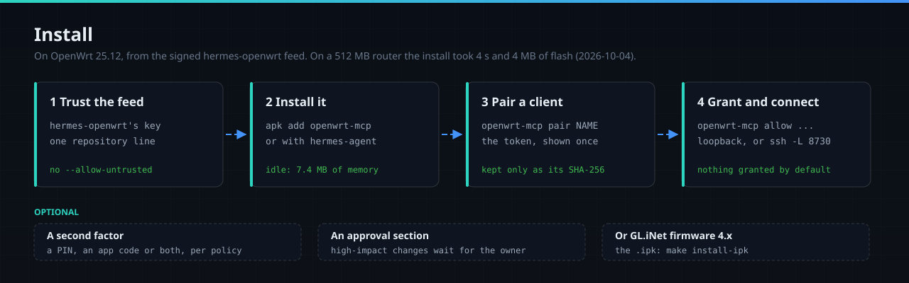

# Installing in detail

The short path is in the [README](../README.md#install): trust the signed hermes-openwrt feed,
`apk add openwrt-mcp`, pair a client, grant it, connect. This page has the rest: SSH access, a
build of your own, the tunnel under systemd, GL.iNet firmware and its status page, and how the
packages are made.



`ROUTER` below is the router's LAN address. Vanilla OpenWrt ships `192.168.1.1` and GL.iNet ships
`192.168.8.1`. Everything is `root@`, because that is the only account OpenWrt has.

## SSH key access

The tunnel and the Makefile's installs run over `ssh` non-interactively, so password auth is not
enough. A factory router has no `authorized_keys` yet:

```sh
ssh-keygen -f ~/.ssh/known_hosts -R 192.168.8.1   # only if that IP held another device before
ssh-copy-id root@192.168.8.1                      # asks for the router password, once
ssh root@192.168.8.1 true                         # must succeed with no prompt
```

Keep the router's password auth enabled: it is the way back in if the key is ever lost.

## From the signed feed (OpenWrt 25.12)

```sh
wget -O /etc/apk/keys/hermes-openwrt.pem \
  https://taipanbox.github.io/hermes-openwrt/hermes-openwrt.pem

echo "https://taipanbox.github.io/hermes-openwrt/25.12/$(cat /etc/apk/arch)/packages.adb" \
  >> /etc/apk/repositories.d/customfeeds.list

apk update && apk add openwrt-mcp
```

These are the first lines of [Install in the hermes-openwrt
README](https://github.com/TAIPANBOX/hermes-openwrt#install), where the feed is published.
`apk add hermes-agent` pulls `openwrt-mcp` in as a dependency. The feed carries
`aarch64_cortex-a53` and `aarch64_generic`.

- **There is no `--allow-untrusted`.** The feed's index is signed, and apk checks it against the key
  you trust.
- **A file you built yourself is unsigned**, and `apk` refuses an unsigned local file, so installing
  one by hand takes `apk add --allow-untrusted ./openwrt-mcp-*.apk`. Signing belongs to a repository
  index rather than to a package, and OpenWrt's own package build does not sign either.
- **The `.apk` filename carries no architecture.** It is in the metadata, and `apk` refuses a
  package built for another one.

The package enables and starts the service. An upgrade from the feed restarts the running daemon on
the new binary:

```sh
apk update && apk upgrade openwrt-mcp
```

To remove it, `apk del openwrt-mcp`; with Hermes on the router, remove it with the hermes-openwrt
packages, as [its README](https://github.com/TAIPANBOX/hermes-openwrt#install) shows.
`/etc/config/openwrt-mcp` is a conffile, so an upgrade keeps your policies, and the tokens and
the rest of the state in `/etc/openwrt-mcp` are left as they are.

## Building it yourself

This fork publishes no `.ipk` of its own. The one on upstream's
[Releases](https://github.com/GlassOnTin/openwrt-mcp/releases) page is upstream's 0.5.0, without the
fork's additions. For an `opkg` firmware such as GL.iNet 4.x, build this fork's package. It needs
**Go 1.27** or newer on the workstation and nothing on the router:

```sh
make install-ipk ROUTER=root@192.168.8.1   # packaged; survives a firmware upgrade
make install     ROUTER=root@192.168.8.1   # straight onto the filesystem, no packaging
make install-apk ROUTER=root@192.168.1.1   # OpenWrt 25.12, unsigned, so --allow-untrusted
```

The router needs no Go, no compiler and no OpenWrt SDK: the binary is statically linked
(`CGO_ENABLED=0`) and cross-compiled on the workstation. `make` uses whatever `go` is on the PATH;
override it with `make install-ipk GO=/usr/local/go/bin/go`. `ARCH` picks the Go architecture
(`arm64` by default), `IPK_ARCH` and `APK_ARCH` the package's.

`make install` writes the binary to a sidecar and renames it, because `cat >` cannot overwrite a
running executable. Only the packaged forms ship the `keep.d` entry that keeps the daemon across a
firmware upgrade, so use `make install-ipk` on a router you mean to keep it on.

GL.iNet firmware 4.x is OpenWrt 21.02 with `opkg`, which the `.ipk` targets; vanilla OpenWrt used
`opkg` up to 24.10. Stock OpenWrt 25.12 replaced opkg with apk, so it needs the `.apk`.

## Connecting a client

The daemon refuses to bind anything but loopback, so a client elsewhere reaches it through SSH:

```sh
TOK=$(ssh root@192.168.8.1 'openwrt-mcp pair claude-code')
ssh -N -f -L 8730:127.0.0.1:8730 root@192.168.8.1
claude mcp add --transport http openwrt http://127.0.0.1:8730/mcp \
  --header "Authorization: Bearer $TOK"
```

`pair` prints the token **once**; it is stored only as a digest and cannot be recovered. Pick a
different local port if 8730 is taken on the workstation (`-L 8731:127.0.0.1:8730`), and point the
client at 8731 to match. Hermes on the router needs none of this: hermes-openwrt pairs its own
client and talks to `http://127.0.0.1:8730/mcp`.

To keep the tunnel up across reboots and drops, run it under systemd:

```ini
# ~/.config/systemd/user/openwrt-mcp-tunnel.service
[Unit]
Description=SSH tunnel to openwrt-mcp
After=network-online.target
Wants=network-online.target

[Service]
ExecStart=/usr/bin/ssh -NT -o BatchMode=yes -o ExitOnForwardFailure=yes \
    -o ServerAliveInterval=30 -o ServerAliveCountMax=3 \
    -L 8730:127.0.0.1:8730 root@192.168.8.1
Restart=always
RestartSec=10
StartLimitIntervalSec=0

[Install]
WantedBy=default.target
```

```sh
systemctl --user enable --now openwrt-mcp-tunnel
```

`Restart=always` handles respawn, and the `ServerAlive` options plus `ExitOnForwardFailure` cover a
connection that is up but dead, so no `autossh` is needed.

OpenWrt's dropbear has no `sftp-server`, so plain `scp` fails with "Connection closed". The Makefile
pipes over ssh instead; use `scp -O` to copy files by hand.

`GET /health` answers `openwrt-mcp <version> ok` and a link to the source, with no token.

## The status page on GL.iNet firmware


On GL.iNet firmware the package adds a page under **Applications -> MCP Server**: whether the
daemon is running, which clients are paired, what each is granted, and the recent audit tail. The
refusal in that tail is the security model at work: `ubus_call` was granted on `network.*`,
`iwinfo.*`, `system.*` and `gl-clients.*`, so `dnsmasq.metrics` was denied, and the denial names
the uncovered scope and prints the `allow` line that would cover it.

It is **read-only**. `pair`, `allow` and `unpair` stay command-line only, so nothing reachable over
the network can widen a grant, the same reason they are not MCP tools. The page explains grants; it
never issues them. It appears in every network mode (router, AP and the rest), since `ubus` and
`uci` exist in all of them.

The data comes from `openwrt-mcp status --json` through an oui-httpd RPC module
(`openwrt-mcp.status`). Status is a CLI subcommand rather than a second HTTP endpoint on purpose: the
daemon's only listener is loopback and reachability is not treated as identity, so another HTTP
surface would mean either exposing policy and audit data to every process on the router, or keeping
a bearer token on the router for the UI to present. oui-httpd already runs as root and can read the
state directory, so a CLI read grants its caller nothing new. `running` in the report asks `/health`
and requires the daemon to name itself, rather than dialling the port, since 8730 is an ordinary
port for something else to hold. On stock OpenWrt the two extra files are inert, so it stays one
package.

A view for this UI needs no GL.iNet SDK and no bundler. The SPA fetches the file as text, `eval`s
it, and uses the resulting value as the route component, so a plain IIFE returning a Vue 2 options
object is enough. The shipped `module.exports=...` bundles work only because a direct `eval`
inherits the enclosing webpack wrapper's scope. Vue is 2.6.12, so render functions avoid needing a
template compiler at eval time. See `ui/view.js`, and `docs/screenshot.js` for how the picture above
is captured.

## How the packages are made

`mkipk.sh` builds the `.ipk` without the OpenWrt SDK: the binary is static Go, so there is nothing to
cross-link and only the archive format is left. Two details, on opkg 1bf042dd (2021-06-13):

- **The container is a gzipped tar, not an `ar` archive.** `.ipk` exists in both forms and most
  documentation describes the `ar` one (identical to `.deb`). This opkg rejects `ar` with
  `pkg_init_from_file: Malformed package file`, both binutils' output and hand-written headers
  without binutils' trailing-slash name quirk.
- **`/etc/config/openwrt-mcp` is declared a conffile**, so an upgrade never clobbers live policies
  or pairings; opkg parks the new default at `...-opkg` instead.

`mkapk.sh` builds the `.apk` with apk-tools v3's `apk mkpkg`, the same command OpenWrt's own package
build ends in, without the 241 MiB SDK. With no apk-tools v3 on the workstation it runs that command
in the 8 MB `alpine:edge` image, so `make apk` needs one or the other, apk-tools v3 or docker. Both
packages stage the same tree:
`/usr/bin/openwrt-mcp`, the procd init script, `/etc/config/openwrt-mcp`, and
`/lib/upgrade/keep.d/openwrt-mcp`, which is how the binary, the init script and the token store
survive `sysupgrade` (GL.iNet's own packages use the same mechanism). On every CI run
`scripts/gate-apk-parity.sh` installs the `.apk` with OpenWrt's own apk inside OpenWrt's published
25.12.4 rootfs images and requires it to land the same files with the same modes as the `.ipk`; how:
[measured.md](measured.md#in-ci-on-every-change).

The feed's package is built from this fork's `main`, at the commit whose `main.go` carries the
version, and signed on a workstation by hermes-openwrt's release process.
