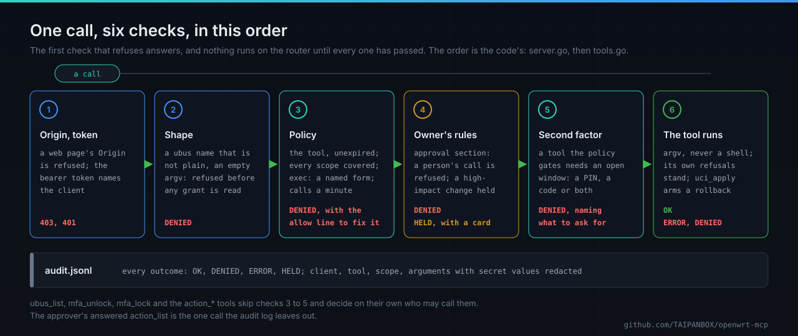
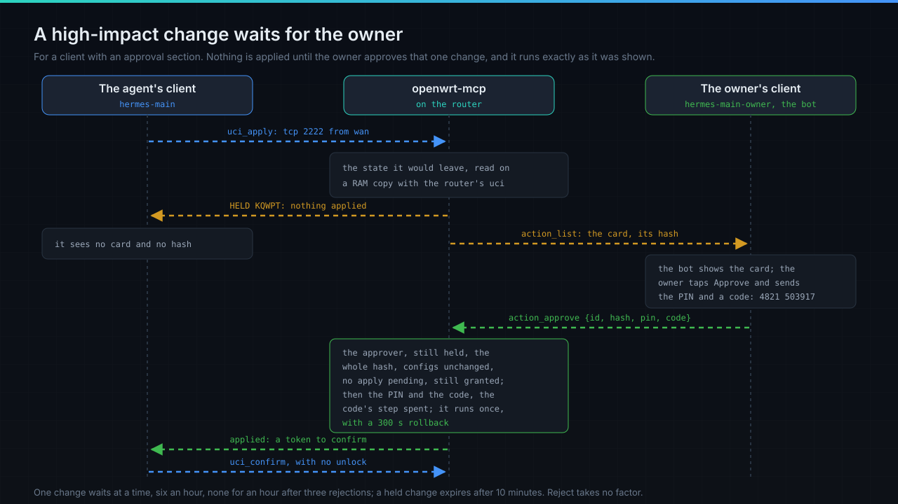

# Security model

openwrt-mcp sits between an agent and the router it runs on. Every call carries its client's token,
meets that client's standing policy, and is written to the audit log; nothing is granted by
default. For a client with an approval section, the owner's rules come next: what only a person may
do is refused, and a high-impact change waits for the owner to approve that one change. The model
is adapted from [Haven](https://github.com/GlassOnTin/Haven)'s MCP backbone.



- [The model at a glance](#the-model-at-a-glance)
- [The second factor](#the-second-factor)
- [High-impact changes wait for the owner's approval](#high-impact-changes-wait-for-the-owners-approval)
- [Secrets: the audit log and `uci_get`](#the-audit-log-never-holds-a-secrets-value)
- [What a client can check for](#what-a-client-can-check-for)
- [How it behaves at its edges](#how-it-behaves-at-its-edges)

## The model at a glance

| | |
|---|---|
| **Reachability** | Loopback only, enforced in code: startup fails on a routable address. SSH key auth is the outer lock, the bearer token the inner one. A request whose `Origin` is not loopback is refused with 403, so a page in a local browser cannot drive the router. |
| **No loopback auto-trust** | Any process on the router can reach `127.0.0.1`, and `ssh -R` can make remote traffic arrive there. Reachability is never treated as identity; origin is recorded for attribution only. A missing or wrong token is answered 401 and audited. |
| **Tokens** | 256-bit, base64url, shown once. Only the SHA-256 digest is stored (mode 0600), compared in constant time. The client's identity comes from the token when it connects, never from a tool argument or a self-asserted name. `unpair` takes effect without a restart. |
| **Authorisation** | Standing policies in `/etc/config/openwrt-mcp`. Deny by default. A policy grants a client a tool list, scope globs, a calls-a-minute ceiling and an expiry, and it can only ever *add* permission. |
| **Refusals are actionable** | A denial names the uncovered scope and prints the `openwrt-mcp allow ...` line that would grant it. |
| **Grant management is CLI-only** | `pair`, `allow` and `unpair` are not MCP tools, so there is no tool for a policy to cover and no self-escalation path through the policy system. The GL.iNet status page is read-only for the same reason. |
| **Rollback** | `uci_apply` reverts unless confirmed, including across a daemon restart or a reboot: the snapshot lives in `/etc/openwrt-mcp/rollback` (0700), not in RAM-backed `/tmp`. |
| **No code execution through `uci_apply`** | `uci_apply` refuses, before staging anything, any change that would make the router run a program or load configuration that can: a firewall include, dnsmasq's `dhcpscript`, uhttpd's interpreters, openvpn's scripts and the like. For every client, always, with no switch. See [tools.md](tools.md#uci_apply-never-makes-the-router-run-code). |
| **Package installs** | `apk_add` installs packages by name from the official OpenWrt feeds on `downloads.openwrt.org` and from nowhere else: never a link, a local file, a custom feed or a mirror, and never with signature checks off. Nothing grants it by default. See [tools.md](tools.md#apk_add-installs-from-the-official-openwrt-feeds-only). |
| **exec arguments** | `exec` runs a program only with an argument form its policy names. A program granted with no form runs with no arguments. See [tools.md](tools.md#exec-runs-only-the-argument-forms-its-grant-names). |
| **Second factor** | A policy can put any of its tools behind the owner's unlock: a PIN, a code from an authenticator app, or both. One unlock opens a window, 15 minutes by default. Guessing costs time that grows, and neither a restart nor a reboot forgives it. See [below](#the-second-factor). |
| **High-impact changes** | For a client with an approval section, a change that opens the router to the internet, weakens the firewall, rewires the network, changes VPN routing, DNS or the time servers, opens Wi-Fi without a password into a trusted network, stops a guard service or reboots is held, whatever the window says, and runs only once the owner's client approves that one change with a PIN and a code. What only a person may do is refused outright. See [below](#high-impact-changes-wait-for-the-owners-approval). |
| **Secrets in the audit log** | A value is written as `<redacted>` when the option, the section or the argument it travels in names a credential. Names stay visible, so the log still shows what changed. See [below](#the-audit-log-never-holds-a-secrets-value). |
| **Secrets in config reads** | Every `uci_get` answer has the value of each secret option (Wi-Fi keys, passwords, private and preshared keys, RADIUS secrets) replaced by `'<redacted>'`, for every client, with no way to turn it off. What a tool answers reaches the agent's model provider. See [below](#uci_get-never-returns-a-secret). |
| **WireGuard private key** | A new client's private key reaches uci on standard input, never as an argument, where every process on the router could read it. |

`ubus_list` is the one tool no grant is asked for that reads the router: introspection returns
method names and argument types, never configuration data.

## The second factor

A broad grant plus a stolen bearer token is root on the router. The token is something the
workstation has; a code from an authenticator app is something the owner has, somewhere else. A
policy names the tools that need it:

```
config policy
	option client 'claude-code'
	...
	list   mfa_tools         'exec'
	list   mfa_tools         'uci_apply'
	option mfa_window        '15m'
	option mfa_factor        'pin+totp'   # totp (default) | pin | pin+totp
	option mfa_max_failures  '5'          # free tries in a row; the one that reaches this starts a delay
	option mfa_lockout       '15m'        # the first delay; each failure after it doubles the wait, up to an hour
```

`list mfa_tools '*'` covers every tool the policy grants. It is off unless configured, so a policy
without it behaves as it always did. `mfa_tools` naming a tool the policy does not grant, or a bad
`mfa_factor`, stops the configuration from loading, with an error naming the option: a typo would
otherwise sit there looking like protection.

### A window, not a code per call

One unlock opens a **time-boxed window** rather than gating every call. An agent works in bursts,
and a control that demands six digits per call gets switched off, which protects nothing. The agent
calls `mfa_unlock` once, the owner gives it a code, and the gated tools work normally until the
window lapses:

```
exec {"argv":["uptime"]}
  -> denied: exec requires a second factor for "claude-code"
     call mfa_unlock with a current 6-digit code from your authenticator; it stays unlocked for 15m0s
mfa_unlock {"code":"552575"}   -> Unlocked until 2026-08-07T07:39:48Z (15m0s).
exec {"argv":["uptime"]}       -> 08:24:51 up 12:57, load average: 2.39 ...
mfa_unlock {"code":"552575"}   -> code already used
```

- The second factor is checked after authorisation, so an unauthorised caller learns nothing about
  which tools are gated.
- Codes are single-use, across a restart too: the last accepted time-step is on the disk. Unlocks
  are per client and held in memory only, so a daemon restart re-locks everything.
- Standard RFC 6238 (SHA-1, 6 digits, 30 s), checked against the RFC's own test vectors, so any
  authenticator app works. A code is accepted for one 30-second step before its own and two after
  it, which is 60 seconds past the moment the app stops showing it: time to type a PIN first. It is
  the same for `mfa_unlock` and `action_approve`.
- An unenrolled client and a wrong code fail with the same text; telling them apart would say which
  clients are worth attacking.
- `mfa_lock` closes the calling client's window at once.
- The `code` and `pin` arguments never reach `audit.jsonl`: they are redacted as they are written.

### Enrolling an app

Run `mfa enrol` yourself over SSH:

```sh
openwrt-mcp mfa enrol claude-code             # prints a QR-scannable otpauth:// URI
openwrt-mcp mfa enrol claude-code --qr        # also draws the QR in the terminal
openwrt-mcp mfa enrol claude-code --json      # one JSON object for a web page: client, uri, secret, qr_png_base64
openwrt-mcp mfa enrol claude-code --pending   # stored apart, out of force
openwrt-mcp mfa activate claude-code 123456   # in force only if that code is valid right now
openwrt-mcp mfa status                        # who is enrolled and what is gated
```

- The router names itself in the account, so an authenticator holding secrets for several routers
  tells them apart: `claude-code@GL-BE14000` rather than a second identical `claude-code`. It
  defaults to the hostname; pass a label to override: `mfa enrol claude-code upstairs`.
- A plain `mfa enrol` makes the new secret live at once, so a QR that was never scanned (or scanned
  wrongly) leaves the client gated behind codes nobody can produce. With `--pending` the secret
  waits in `mfa.pending` and unlocks nothing; `mfa activate` moves it into force only after a code
  from the authenticator has proved it works, and refuses (keeping it pending) on a wrong, expired
  or missing code. Any secret already in force keeps working until then, so it is also the safe
  way to rotate. The code used to activate is recorded as spent in `mfa.used`, keyed to the new
  secret, so the running daemon refuses it too.
- The secret is printed once and is *recoverable* from `/etc/openwrt-mcp/mfa` (mode 0600), unlike
  bearer tokens, which are stored only as digests: TOTP is symmetric. So anything that sees your
  terminal or that file can generate codes. Enrolling on someone else's behalf, or pasting the
  secret into a chat, defeats the point of a second factor.
- The running daemon reads an enrolment made by the CLI as soon as the file changes, and rotating a
  secret closes any window opened under the old one.

### A PIN, a code, or both

```sh
printf '%s\n' "$PIN" | openwrt-mcp pin set claude-code   # 4 to 8 digits, read from stdin
openwrt-mcp pin clear claude-code
```

- The PIN is read from one line of stdin and never from an argument (which would sit in `/proc` and
  in shell history). Only a salted PBKDF2-HMAC-SHA256 hash is stored, in `/etc/openwrt-mcp/pin`
  (0600), checked in constant time.
- A PIN changed or cleared from the CLI takes effect on the running daemon, closing any window
  opened under the old one.
- `mfa_unlock` then takes `{"code": "...", "pin": "..."}` and requires exactly the factors the
  policy names. With `pin+totp` the PIN is checked first, so a wrong PIN never spends the owner's
  code, and no refusal says which factor was wrong.

### Guessing costs time, and the time grows

A PIN is short and a code is six digits, so the throttle is what protects them. `mfa_max_failures`
tries in a row are free. The failure that reaches that limit costs a wait of `mfa_lockout`, each
failure after it doubles the wait, and it stops at one try an hour (at `mfa_lockout`, if that is
longer):

| Failed tries in a row | Wait for the next try |
|---|---|
| 1 to 4 | none |
| 5 | 15 minutes |
| 6 | 30 minutes |
| 7 and every one after | 1 hour |

That is 30 tries in the first day and 24 a day after it. A try inside a wait is refused without
looking at any factor, without counting and without writing anything, and the refusal says when the
wait ends. The end of a wait gives one try, not the free ones back. A success resets the count, and
so do 24 hours of uptime with no counted failure; a refused try does not keep the count alive.

```
mfa_unlock {"pin":"0000"}   -> invalid credentials              (x5)
mfa_unlock {"pin":"4821"}   -> too many failed attempts: unlocking is locked out until 2026-10-01T22:15:00Z
mfa_lock {}                 -> Locked. The unlock window for claude-code is closed; ...
```

**What is kept where.** `/etc/openwrt-mcp/throttle` (0600, carried across a firmware upgrade with the
rest of the directory) holds one line per client: the failure count and the last accepted TOTP
step. It holds no time. A router with no battery boots with an old clock and ntpd then jumps it, so
a stored "not before" would be skipped by a jump forward, stretched by a wrong clock and reset by a
forged time server. The moment of the next try lives in the daemon's memory on the monotonic clock
instead, and a daemon that starts treats its own start as that moment:

- **A restart or a reboot forgives nothing.** A client at or above the limit starts a fresh delay of
  the length its count asks for, so a restart costs a guesser time and costs anyone at most one more
  delay. The clock can jump either way without moving a wait. The 24 hours are uptime, and they start
  again with the daemon.
- **The count is on the disk before any factor is looked at**, and cleared on a success, so a process
  that dies between the check and the write has not given a free guess. Each write goes to a
  sidecar, which is synced, renamed over the file, and the directory synced.
- **A corrupt record reads as the limit**: one first delay, neither a free pass nor a punishment. A
  missing file reads as zero, which is a new install.
- **A failed write keeps working from memory.** On a full overlay the daemon counts in memory, says so
  once in the log, shows `throttle_persisted: false` in `status`, and writes again as soon as it
  can. A full disk never becomes a refusal. A restart in that state goes back to the last count that
  reached the disk.
- **Tries made at the same moment** are taken one at a time, so none slips under the limit.

**Who can clear a count.** Root, from the router:

```sh
openwrt-mcp mfa reset claude-code       # takes effect on a running daemon, with no restart
```

A new PIN or a new enrolment clears it too. The last accepted step survives a reset, so a spent code
stays spent. No MCP client can reset a count: there is no tool for it, as there is none for `pair`
or `allow`, and `mfa_lock` leaves the count alone.

**A weak PIN.** `pin set` refuses the most common PINs, from a short built-in list: the free tries
come first, so a PIN from the top of that list falls inside them whatever the delays are. A PIN
already on file keeps working.

`@decided 2026-11-07`: there is no overall cap on the tries. The count is per client and shared by
whoever holds that client's token, so a cap that disables the factor would let a guesser turn a
stolen token into a lockout that stays after the guessing stops, and on a home router that means
going to the router. With delays alone, a lockout does not outlive the attack: once the guessing
stops, the wait is over within the hour and a day clears the count. While the guessing goes on, it
takes the tries as they come up, and the owner gets in with `mfa reset` from the router, or with a
new PIN. This is a deliberate departure from the limit in NIST SP 800-63B-4 section 3.2.2, which
stops consecutive failures at 100 at most by disabling the authenticator and offers a growing wait
of up to an hour only as an addition to that limit. openwrt-mcp claims no conformance with it. The
price of the choice falls on one configuration: a four-digit PIN as the only factor can be walked
through in 14 months of unbroken guessing at 24 tries a day. `pin+totp`, or a longer PIN, puts that
out of reach.

## High-impact changes wait for the owner's approval



An unlock window lets a client change settings, the VPN and services, each with a rollback. Some
changes are too consequential for a window, and a rollback does not undo what they let happen while
they stood: a port opened to the internet, the firewall weakened, VPN routing or DNS changed. For a
client given an approval section those are held. Nothing runs; the daemon keeps a record of the
exact call in memory, writes a card for it, and only the client named as approver can approve it,
one change at a time, with the owner's PIN and a current code, against the hash of that card.

```
config approval 'hermes_main_approval'
	option client    'hermes-main'
	option approver  'hermes-main-owner'
	option factor    'pin+totp'      # or totp; a PIN alone is refused, it is not fresh
	option ttl       '10m'           # how long a held change waits
	option max_open  '1'             # changes waiting at once
	option max_per_hour '6'          # proposals an hour
	option pause_after_rejects '3'   # rejections in a row before proposals pause
	option pause     '1h'
	option approvals 'on'            # off: a high-impact change is refused, nothing waits
	list hold   'ubus_call:network.restart'   # more to hold: <tool>:<scope glob>
	list refuse 'uci_apply:mwan3.*'           # more to refuse
```

A policy may say `option approval '<section>'`, which makes the configuration fail to load without
that section, and `option hold '1'`, which holds everything it grants. A hold policy, and a
`list hold` rule, may name only `uci_apply` and `ubus_call`, the tools an approval can run. The
approver must be a different client from the one it approves.

`@decided 2026-10-22`: the design for hermes-openwrt's owner profile, paraphrased in `approval.go`'s
header: reads always; reversible changes in the unlock window; high-impact changes held as an
immutable record and approved one by one from the owner's own client, with a fresh PIN and code,
against a hash of exactly the batch shown; what only a person may do, never.

### What is held

What decides a `uci_apply` is the state the batch would leave, not the batch: it is applied to a
copy of the configs in RAM with the router's own `uci -c <copy> -P <copy>`, both states are read with
`uci -X show`, and they are compared. So a port forward created disabled and switched on in a second
call is held on the second call, although all it says is `enabled=1`. A zone faces the internet when
its networks include `wan` or `wan6`, or it masquerades. Keywords are read trimmed and in any case,
and a value the rules do not know reads as the one that opens: a redirect target other than SNAT is
a DNAT, a policy other than REJECT or DROP is an ACCEPT.

| Held | Read as |
|---|---|
| A port opened to the internet | an enabled redirect (any target but SNAT) or rule (any target but DROP or REJECT, unset included) from an internet zone or `*`, not there before |
| The firewall weakened | an internet zone's input or forward becoming ACCEPT (an unset policy reads as the defaults' one), a forwarding from an internet zone, a change in which zones face the internet (a zone that takes a `device` or a `subnet` counts as one), any change to what a zone takes by `device` or `subnet`, a network on the internet side (`wan`, `wan6`, or one an internet zone lists, such as a station-mode Wi-Fi uplink) put into a zone that does not face the internet, and any change to a raw nftables fragment (`extra`, `extra_src`, `extra_dest`) anywhere in the firewall |
| The network rewired | any change to a `bridge-vlan`, `switch_vlan` or `switch_port` section, to the `ports` or `ifname` of a device (one added or removed included), or to what an interface sits on (`device`, `ifname`), whatever it names: netifd decides which port ends up carrying the internet, so every such change is held and none is traced. The one shape that runs is an interface put on a new bridge made in the same change with neither ports nor `ifname`, `type bridge` and named `br-<name>` with no dot or `@` and no device of that name in the kernel yet, which is how a guest network is set up |
| VPN or policy routing | any change to a WireGuard interface or peer, a route or rule for every destination added, changed or removed, anything in `pbr` |
| Who answers DNS | dnsmasq's `server`, `address`, `noresolv`, `resolvfile`, `rebind_protection`; DHCP option 6; a host, domain or cname for a name with a dot; an interface's `dns` and `peerdns` |
| The time servers | any change to a `timeserver` section: the codes are only as good as the clock |
| Open Wi-Fi into a trusted network | an enabled access point with no password (`none`, unset, `owe`) whose network is in a zone that accepts input and does not face the internet |
| A guard stopped, a reboot | `rc.init` stopping or disabling firewall, dropbear, uhttpd, rpcd, openwrt-mcp, network or dnsmasq; `system.reboot` |
| What cannot be checked | a state that cannot be read waits for the owner, and the card says why |

### What only a person may do

For a client with an approval section, these are refused whatever its grants say, with the window
open or not: `exec`, `wg_new_client` (its answer is a private key), a change to the configs `hermes`,
`openwrt-mcp`, `rpcd`, `dropbear`, `uhttpd`, `luci`, `fstab` and `ucitrack`, and the ubus methods
`file.*`, `system.sysupgrade`, `system.signal`, `service.*`, `uci.*` and `rpc-sys.*`. Such a client
also never opens its own window: `mfa_unlock` refuses it without counting a try, and its approver
opens it, so the agent cannot spend the owner's tries on guesses.

### The card

The card is the daemon's. It is written from the record: a headline built from parsed values
(addresses through `netip`, ports as numbers, anything else shown as unreadable), then every changed
key with its value before and after. A secret's value reads `<redacted>`; whatever the client chose
is quoted after its key with anything unprintable escaped, so a right-to-left override or a line
break cannot reorder or forge a line. A card over 3500 characters is refused, never cut short:

```
Router change waiting for you (KQWPT, ref 3f9a12c0, expires in 10 min)
Asked by hermes-main:
OPENS THE ROUTER TO THE INTERNET: tcp 2222 from any address to 192.168.1.20:22

firewall.ssh_nas, new redirect
  + dest 'lan'
  + dest_ip '192.168.1.20'
  + dest_port '22'
  + proto 'tcp'
  + src 'wan'
  + src_dport '2222'
```

The record's hash covers its id, the client, the tool, the normalised input, the card, the
fingerprint of the configs it was checked against and its times, so an approval of a hash is an
approval of everything the owner was shown and of nothing else. The record is never edited: only its
status changes. The agent's own view of its held changes carries no card and no hash.

### Proposing

A client may propose while its window is closed: at most one change waiting, six an hour, and none
for an hour after three rejections in a row. The answer is not an error, and the agent is told not
to retry:

```
HELD KQWPT until 2026-10-22T12:44:00Z
This change waits for the owner's approval, ...
```

A high-impact change from a client whose approval cannot work yet (approvals off, the approver not
paired, no PIN or no app set up) is refused with the reason, and nothing is applied.

### Approving

`action_approve {id, hash, pin, code}` from the approver checks, in order and without counting a
try: that the caller approves that client, that the change is still held, that the hash is the
record's whole hash, that the configs it was checked against are unchanged on disk, that no other
apply waits for confirmation, that no uncommitted uci edits exist, that a policy still grants it, and
that approval can work (on, the approver paired, the PIN and the app set up). Only then are the
factors checked, against the same failure count and lockout as an unlock, and the code's step is
spent, so it neither approves another change nor opens the window. The stored call then runs once
through the tool's own function, so `uci_apply`'s own refusals still stand, with a rollback of 300
seconds that the client may confirm without an unlock; the configs are compared once more as the
last step before anything is staged. An approval never opens or extends the window, and a window
approves nothing. Rejecting takes no factor; the approver's `mfa_lock {client}` closes that client's
window and rejects every change it has held.

### How far the rules reach

They read the state a change leaves, so a change whose danger lies in a value they do not read (a
port forward to a host that runs something, a firewall zone's extra rules, a package's own
remote-administration switch, an mwan3 or sqm setting) runs in the window like any other, with the
rollback; `list hold` and `list refuse` add rules for those. The records live in the daemon's
memory, so a restart drops every held change and the client proposes again. `status` runs as its
own process and reports each client's approval facts (approver, factor, on, ready), read from files;
the held changes are listed by `action_list`.

## The audit log never holds a secret's value

Every call is recorded in `/etc/openwrt-mcp/audit.jsonl` with its client, tool, scope and arguments,
and an outcome: `OK`, `DENIED`, `ERROR` or `HELD`. `DENIED` is a distinct outcome from `ERROR`: "we
said no" is not "it broke". Calls are recorded at the wrapper, so a new tool is logged without opting
in, and the recorder redacts by name rather than trusting callers, so a new tool cannot leak a
password by forgetting to scrub it:

- A `uci_apply` change whose **option** or whose **section** names a credential has its `value`
  replaced by `<redacted>`. A credential name is one the router's own config uses for a secret
  (`key`, `password`, `private_key`, `psk`, `secret`, `token` and the rest of the list in
  `uci_redact.go`), or one the log has always redacted.
- An `exec` argument of the form `name=value` whose name is a credential has its value replaced, and
  so does the argument after a credential name (`private-key FILE`, `--password VALUE`). The summary
  on the audit line is built from the same redacted arguments.
- An argument named `code`, `pin` or `otp`, which is how `mfa_unlock` and `action_approve` carry
  the owner's factors, is redacted in every call.
- A uci record quoted in an error or a summary is redacted the same way.

Option and section names stay visible, and a WireGuard `public_key`, `keyId` and `publicKey` are
identifiers rather than secrets, so they stay: redacting them would make the log useless. The
redaction is by name: a value under a name that gives no sign of a secret is written as it is. The
log holds arguments and a summary, never what a tool returns. At 16 MB (`audit_max_mb`) the log
moves to `audit.jsonl.1`, and one generation is kept. The approver's answered `action_list`, which it
polls every few seconds, is the one call left out, so the log stays readable and the flash is
spared; a refused listing is kept.

Some refusals cost the caller nothing and can be repeated as fast as a loop runs. A line each would
wear the flash and let a guesser rotate the record of what it did out of the log, so a run of them
is folded: the first is written in full, the rest are counted, and one summary line with a `folded`
count follows. That holds for a try refused inside a delay (`mfa_unlock` and `action_approve`; the
run ends with the delay), for a bad or missing bearer token, which any process on the router can
send, and for an `mfa_unlock` turned away before any try, which the agent's own token can send (those
two runs last 15 minutes, so a flood costs two lines per 15 minutes, whatever its size). A counted
failure always has a line of its own, and the delays ration those. Summaries are written within a
minute of a run's end, and when the daemon is told to stop. The folding covers those refusals and no
others: a client with a valid token can still fill the log with calls of its own, each with a
line, and those lines name it.

## `uci_get` never returns a secret

Whatever a tool returns goes into the agent's context, and from there to the agent's model provider.
An agent setting up a guest network has to read the Wi-Fi configuration, and that config holds the
passphrases next to the SSIDs. So `uci_get` replaces the value of every secret option with a fixed
marker, in every answer, for every client:

```
wireless.default_radio0.ssid='Home Net'
wireless.default_radio0.encryption='psk2'
wireless.default_radio0.key='<redacted>'
network.wg0.private_key='<redacted>'
network.peer1.public_key='hQ7r...='
```

- **By option name, in every config.** The list is in `uci_redact.go`, each entry with the config it
  comes from: the Wi-Fi `key`, `key1` to `key4`, `sae_password`, the EAP passwords and private keys,
  `auth_secret`, `acct_secret`, `dae_secret`, `r0kh` and `r1kh`; WireGuard `private_key` and
  `preshared_key`; the PPP, L2TP, 6in4 and VPN passwords; the SIM `pincode`; uhttpd's, dropbear's
  and OpenVPN's key files; and the families `*key`, `*password`, `*passwd`, `*pass`, `*pwd`,
  `*secret`, `*_psk`, `*token`, `*pin`. A WireGuard peer's `public_key` and the `*_rekey` intervals
  stay readable. A value that is only the path of a key file is hidden too: being wrong in that
  direction costs nothing.
- **Narrowing or widening the read does not get around it.** The redaction works on what `uci show`
  prints, so a whole config, one section and the option itself by name all come back the same way.
  It reads that output by libuci's own grammar, so a value with a quote, a list, or a newline in it
  is hidden whole, not just its first line.
- **There is no switch.** `uci_get` takes a config, a section and an option, nothing else.
- **The marker is not a value.** `uci_apply` refuses `<redacted>` as a value, so an agent copying
  one network's settings to another cannot give it a passphrase printed in this document. To set a
  secret, the agent asks the operator for it, and `uci_apply` taking that value as input is
  expected: the operator chose to give it.
- **The same redaction covers what quotes a config:** `uci_apply`'s refusal to start on top of
  someone else's uncommitted edits lists those edits redacted, and so is the error `wg_new_client`
  returns when it cannot read the WireGuard server's config, which holds the server's private key.

How far it reaches:

- **`uci_get` is the redacted read path.** `ubus_call` returns what the ubus method returns, and some
  return config with the keys inside it: `network.wireless status` lists every interface's
  settings, `key` included, and rpcd's `ubus call uci get` returns any option's value. Keep those
  objects away from an agent whose context should not hold the keys. `exec` reads
  `/etc/config/wireless` as it is, and `wg_new_client` returns the new client's private key by
  design.
- **The match is by name.** A secret under a name that gives no sign of it, such as a token pasted
  into a ddns `update_url` or a password inside ppp's `pppd_options`, is returned as it is.
- **Some harmless settings are hidden** because their names end like a secret's: for example
  `sae_ext_key`, OpenVPN's `persist_key`, GRE's `ikey`/`okey`, vpnc's `hexpasswd`. The rule errs
  that way on purpose.

## What a client can check for

`openwrt-mcp status --json` reports the guarantees this binary makes, by name, so a caller tests for
the one it depends on rather than comparing versions:

```sh
openwrt-mcp status --json --audit 0 | jsonfilter -e '@.capabilities'
```

| Capability | Since | What it promises |
|---|---|---|
| `uci_get_redacts_credentials` | 0.5.0.2 | every `uci_get` answer has secret values redacted |
| `uci_apply_refuses_code_exec` | 0.5.0.3 | `uci_apply` never makes the router run code |
| `apk_add_official_feed_only` | 0.5.0.4 | `apk_add` installs from the official feeds only |
| `actions_held_for_approval` | 0.5.0.5 | high-impact changes wait for the owner's approval |
| `second_factor_throttle_persisted` | 0.5.0.8 | the guess throttle outlives a restart and a reboot, and the disk holds no time |

The same report gives each client's `mfa` object (`factor`, `totp_enrolled`, `totp_pending`,
`pin_set`, `failures`, and `live_state`) and, for a client with an approval section, its `approval`
object. `status` runs as its own process, so it reads the factor, the enrolment and the failure count
from files and reports `live_state: false`; `unlocked_until` and `locked_out_until` are filled in only
by a process that holds the daemon's own state. There is no control channel from `status` into the
daemon, on purpose. What `status` does read from it is `/health`, the check that it is running, and
that answer adds the line `throttle_persisted: false` while the count is not reaching the disk: that
is the report's top-level `throttle_persisted`, and `true` means no failed write is known.

For the owner's chat, `action_list` carries a `throttle` list beside the held changes: per client it
approves, `failures`, `limit`, `locked_out_until`, `refused` (tries refused inside the current delay)
and `persisted`. Tries reach that list only through the owner's token or from a client with no
approval section, since the agent's own token spends none, which makes it what a plugin needs to
tell the owner that someone else is trying. The agent's own view carries none of it.

## The daemon runs in a jail

The daemon is root, and stays root: it commits `/etc/config` (mode 0600 for `network` and
`wireless`), starts `uci`, `ubus` and `apk` for an agent, and `apk_add` writes anywhere in the root
file system. What the init script takes from it is what those jobs never use. It is checked in
`scripts/gate-jail.sh` and shown on a running router by `scripts/e2e-vlab.sh`.

| Taken away | How |
|---|---|
| Most of the file system | procd's jail has `/etc`, `/usr`, `/lib`, `/bin`, `/sbin`, `/www` and `/tmp` with the run-time directories under `/var`, all read-write because `apk_add` can write into any of them. `/root`, `/overlay`, `/mnt`, `/rom`, `/boot` and every device node but `null`, `zero`, `full`, `random`, `urandom`, `tty`, `ptmx` and the log socket are not there; `/sys` and `/proc/sys` are read-only |
| The router's process table | a pid, ipc, mount and uts namespace of its own; the network namespace is the router's, because the daemon listens on its loopback and the programs it starts configure its interfaces |
| Nearly every capability | `/etc/capabilities/openwrt-mcp.json` names nine in all five lists, so the bounding set holds for every program the daemon starts: `CAP_CHOWN`, `CAP_DAC_OVERRIDE`, `CAP_FOWNER`, `CAP_FSETID`, `CAP_KILL`, `CAP_SETUID`, `CAP_SETGID`, `CAP_NET_ADMIN`, `CAP_NET_RAW`. Without `CAP_SYS_ADMIN`, `CAP_SYS_MODULE`, `CAP_SYS_RAWIO`, `CAP_SYS_PTRACE`, `CAP_SYS_BOOT`, `CAP_SYS_TIME`, `CAP_MKNOD` and the rest |
| Privilege from a setuid file | `no_new_privs` |
| Forty system calls, and clone into a namespace | the daemon's own seccomp filter ([seccomp/denied.txt](../seccomp/denied.txt)): `ptrace`, `mount` and the new mount API, `unshare`, `setns`, the module calls, `kexec`, `reboot`, `bpf`, `keyctl`, the clock calls and the file-handle calls end the caller with SIGSYS; `clone` with a namespace flag does the same, and `clone3` answers ENOSYS so libc falls back to `clone`, whose flags the filter can read |

The filter is the daemon's own and not procd's profile, because procd applies a profile through
`LD_PRELOAD`, which a static Go binary never loads. It is a deny-list, not an allow-list, because the
daemon starts `uci`, `ubus`, `apk` and whatever a grant names, and every one of them inherits it. It
goes on first thing in `serve`, on every thread, and the daemon does not listen unless
`/proc/self/status` shows `NoNewPrivs: 1` and `Seccomp: 2`. It is built for amd64 and arm64 and is
off elsewhere. The init script says `requirejail`: on a router where ujail cannot build the jail the
daemon does not start, rather than running outside it.

What this takes from a program started by `exec`, which the jail cannot give back without giving
the jail up:

- it sees only the jail's own processes, so `ps`, `pidof`, `kill` and `killall` do not reach the
  router's; `reboot` (busybox signals pid 1, which is the jail's) and `ubus call system reboot` are
  not the same thing: only the second reaches the router;
- `sysupgrade -b` stops with "Cannot save config while running from ramdisk", because the jail's root
  is a tmpfs; `firstboot` and `mtd` need `/overlay` and the flash devices;
- `mount`, `unshare`, `insmod` and `date -s` end with SIGSYS or a refusal.

`ubus call system sysupgrade`, a service restart through its init script, `ip`, `wg`, `ping`,
`nft`, `logread`, `uci` and `apk` work, and so do all the other tools; `jail_vlab_test.go` runs each.

## How it behaves at its edges

- **A client without an approval section has nothing denied permanently.** `sysupgrade`,
  `firstboot` and `mtd` are reachable if a policy grants them, which keeps recovery access to hand.
  For a client with an approval section, the list in [What only a person may
  do](#what-only-a-person-may-do) is refused whatever it is granted.
- **A broadly scoped `exec` grant is a root shell**, and from a root shell `openwrt-mcp allow`
  grants anything else. Scoped grants (`exec` limited to named programs, each with the argument
  forms it needs) keep the policy engine meaningful; an unscoped one reduces it to an audit trail.
- **An argument form is a pattern, not a program.** `sh -c *` is a shell, and a `*` in an argument
  matches any text, dots and dashes included, within that one argument. Exact forms are safer.
- **Unlock windows live in the daemon's memory only**, so a restart re-locks everything. Failure
  counts are on the disk, and a restart forgives none of them.
- **The throttle is per client** and anyone holding that client's bearer token can trigger it: five
  wrong guesses deny the owner an unlock for `mfa_lockout`, and a guesser who keeps going takes each
  try as it comes up. It grants the guesser nothing, and a lockout does not outlive the attack. The
  owner lifts it at once from the router with `openwrt-mcp mfa reset`, or by setting a new PIN or
  re-enrolling, which also closes the old window. Away from the router, with no way in, the wait is
  what is left, and it ends with the guessing.
- **What is held is decided by named rules** over the state a change leaves, and a rule is a list.
  A change whose danger lies somewhere no rule reads runs in an unlock window, with the rollback: a
  Wi-Fi interface's `network` (an access point or a station joined to any network, the internet
  side included), an interface removed or left with no device, a device's other options, a setting
  of a package the rules do not know, or a value whose meaning is decided at run time.
- **Rate-limit windows are process-scoped**, so a restart resets them, erring toward allowing what
  was already granted.
- **`uci_get` redacts secret option values; `ubus_call` and `exec` return what they read**, and some
  ubus methods (`network.wireless status`) return the Wi-Fi keys.
- **`make install-ipk` survives a firmware upgrade and `make install` does not:** only the packaged
  form ships the `keep.d` entry. The `.apk` from the feed ships it too.
