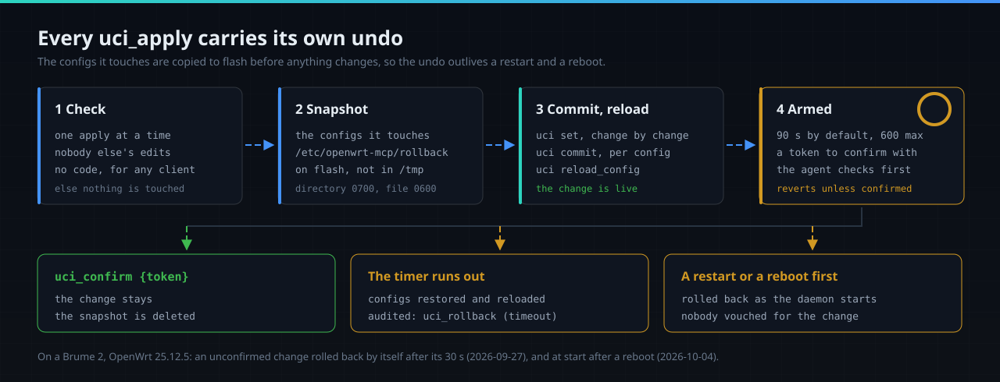

# The tools

openwrt-mcp exposes sixteen generic tools rather than a hand-written catalogue of router features.
`ubus list -v` already describes every object, method and argument signature on the router, so the
agent discovers what this router can do instead of trusting a list that goes stale with each
firmware update. On a GL.iNet router that means the vendor's own `gl-*` objects come through
without a line of code per feature.

Every tool runs behind the same gate (shown in [call.svg](call.svg)): the client's token, its
standing policy, for a client with an approval section the owner's rules, the second factor, and
the audit log. Nothing is granted by default.

- [The sixteen tools](#the-sixteen-tools)
- [Granting a tool](#granting-a-tool)
- [`ubus_call`: object and method pairs](#ubus_call-grants-are-object-and-method-pairs)
- [`uci_apply`: changes with an armed rollback](#uci_apply-changes-with-an-armed-rollback)
- [`uci_apply` never makes the router run code](#uci_apply-never-makes-the-router-run-code)
- [`uci_get`: the read path](#uci_get-the-read-path)
- [`exec`: only the argument forms its grant names](#exec-runs-only-the-argument-forms-its-grant-names)
- [`apk_add`: the official OpenWrt feeds only](#apk_add-installs-from-the-official-openwrt-feeds-only)
- [`wg_new_client`](#wg_new_client)
- [How much a tool returns](#how-much-a-tool-returns)

## The sixteen tools

| Tool | Policy scope | |
|---|---|---|
| `ubus_list` | *(ungated)* | Objects, methods and argument signatures. The discovery tool: introspection returns method names and argument types, never configuration data, and without it an agent cannot discover what to ask for. |
| `ubus_call` | `<object>.<method>`, matched as a pair | The workhorse: netifd, wireless, dnsmasq, iwinfo, luci-rpc, `gl-*`. A grant covers the object and the method it names; see [below](#ubus_call-grants-are-object-and-method-pairs). Replies over 8 KB have long arrays pruned; see [How much a tool returns](#how-much-a-tool-returns). |
| `uci_apply` | `<config>.<section>.<option>`, or `<config>.<section>` for a section-level change | Check, snapshot, stage, commit, reload, rollback armed. Sets options, and creates or deletes whole sections. Every scope must be covered by one policy. |
| `uci_confirm` | *(tool-level)* | Cancels the rollback timer of a pending `uci_apply`. |
| `uci_get` | `<config>`, `<config>.<section>` or `<config>.<section>.<option>` | Reads configuration as `config.section.option=value` lines, narrowed by config, section or option: the read path `uci_apply` lacks, safer than an exec shell for inspecting state first. A section- or option-level read is covered by a `<config>.*` grant; a whole-config read needs `<config>`. Secret values read `'<redacted>'`. |
| `exec` | `argv[0]`, and the argument forms the policy names for it | Direct exec, **no shell**: no pipes, globs or redirection, and no quoting surface. A program with no argument form runs with no arguments; see [below](#exec-runs-only-the-argument-forms-its-grant-names). |
| `logread` | *(tool-level)* | The system log, up to 2000 recent lines, with an optional substring filter. Split out from `exec` so logs can be granted without a root shell. |
| `wg_new_client` | `wireguard_server.<server section>`, or `wireguard_server` when unspecified | Issues a WireGuard client: keypair, next free tunnel address, a peer the vendor UI still lists, hot-added with `wg set` so live sessions stay up. Returns the config **and a UTF-8 QR** to scan. Emits a private key; see [below](#wg_new_client). |
| `apk_add` | the package name, for each package named | Installs packages from the official OpenWrt feeds (OpenWrt 25.12 and newer), by name only. `dry_run` lists every package that would be installed or changed and installs nothing; see [below](#apk_add-installs-from-the-official-openwrt-feeds-only). |
| `mfa_unlock` | *(ungated)* | Supplies the owner's factors (`code`, `pin`, or both, as the policy's `mfa_factor` says) to open the second-factor window. Ungated because it is how the factor is satisfied; it grants nothing without the right factors, and repeated failures cost a wait that grows up to an hour and that a restart does not clear. A client with an approval section never opens its own window; its approver opens it, with `client`. |
| `mfa_lock` | *(ungated)* | Closes the calling client's unlock window at once. Ungated because it only removes access. The approver, with `client`, closes that client's window and rejects every change it has held. |
| `action_status` | *(ungated)* | The client's own held changes: held, applied, failed, rejected, expired or withdrawn, with the outcome of one that ran. An applied `uci_apply` names its `uci_confirm` token. |
| `action_withdraw` | *(ungated)* | Withdraws one of the client's own changes that still waits. |
| `action_list` | *(the approval section)* | For the approver only: the held changes of the clients it approves, each with its card and hash, and beside them a `throttle` list: per client, `failures`, `limit`, `locked_out_until`, `refused` and `persisted`, so the owner's chat can say that someone else is trying. |
| `action_approve` | *(the approval section)* | For the approver only: approves one held change by its id and the hash of its card, with the owner's PIN and a current code. The change runs once, exactly as held. |
| `action_reject` | *(the approval section)* | For the approver only: rejects one held change. Takes no factor. |

How the second factor and held changes work: [security.md](security.md). `openwrt-mcp mfa reset
<client>` clears a client's failed tries; it is a root command on the router and no tool, so no MCP
client can reach it.

## Granting a tool

`pair`, `allow` and `unpair` are command-line only, so there is no tool for a policy to cover and
no way for a client to widen its own grants.

```sh
TOK=$(ssh root@192.168.1.1 'openwrt-mcp pair claude-code')     # the token, printed once
ssh root@192.168.1.1 "openwrt-mcp allow claude-code ubus_list,ubus_call,logread 'network.* network.*.* iwinfo.* system.*' 30d"
ssh root@192.168.1.1 'openwrt-mcp policies'                     # what is granted
ssh root@192.168.1.1 'openwrt-mcp unpair claude-code'           # every token of that client, at once
```

A policy lives in `/etc/config/openwrt-mcp`:

```
config policy
	option client       'claude-code'
	list   tools        'ubus_call'
	list   tools        'logread'
	list   scopes       'network.*'
	list   scopes       'iwinfo.*'
	option max_per_min  '60'
	option expires      '2026-12-31'
	option enabled      '1'
```

- A policy grants a client a tool list, scope globs, a calls-a-minute ceiling and an expiry, and it
  can only ever add permission. One rate token is spent per authorised call, not per scope.
- A refusal names the scope no policy covers and prints the `openwrt-mcp allow` line that would
  cover it. Start narrow: loosening is one command, and a grant that is too wide is expensive to
  notice.
- Scopes are matched with Go's `path.Match`, so a `[...]` in a grant is a character class. A grant
  on an anonymous section escapes its brackets: `system.@system\[0\].description`. The refusal
  prints the scope as it was asked, with the brackets bare.
- `revoke` is an edit of `/etc/config/openwrt-mcp` and a restart; `unpair` takes effect without a
  restart.

## `ubus_call` grants are object and method pairs

A `ubus_call` scope is `<object>.<method>`, and a grant covers the object and the method it names,
each matched on its own. The object part of a grant ends at its last dot:

- `iwinfo.*` covers every method of the object `iwinfo`, and not `iwinfo.devices`, which is a
  different object.
- `network.*` covers the object `network` only. To cover the objects below it as well, add
  `network.*.*`.
- `iwinfo.devices` covers exactly that one method.
- `*` covers every object and method.

A grant with no dot, such as `gl-*`, covers nothing; write `gl-*.*`. An object or method that is not
a plain ubus name is refused under every grant: an object is letters, digits, dots, dashes and
underscores, a method is the same without dots, and neither begins with a dash. Before this rule,
`network.*` covered every object beginning `network.` and `gl-*` covered every `gl` object; both
grants need the forms above now.

A grant of `ubus_call` on `system.*` also covers `system.reboot`. Grant methods by name for anything
that should stay read-only.

## `uci_apply`: changes with an armed rollback



`uci_apply` checks the batch, snapshots the configs it touches, stages the changes, commits, reloads
and **arms a rollback timer**: 90 seconds by default, up to 600. If `uci_confirm` is not called
before it runs out, the router puts everything back. A firewall rule that locks the agent out
repairs itself while it is still typing.

```
uci_apply  {"changes": [{"config":"firewall","section":"@zone[1]","option":"input","value":"DROP"}],
            "timeout": 120}
  -> "ROLLBACK ARMED: reverts at 15:07:22Z (in 2m0s) unless you call uci_confirm {...}"

  ... the agent checks it can still reach the router ...

uci_confirm {"token": "3Kc681oIe4IP"}
  -> "Confirmed. Rollback cancelled."
```

A change with `type` and no `option` **creates** a section, so whole objects go in under one
rollback. Pinning a DHCP lease is one call:

```
uci_apply {"changes": [
  {"config":"dhcp","section":"raspberrypi","type":"host"},
  {"config":"dhcp","section":"raspberrypi","option":"mac","value":"88:a2:9e:8a:e4:15"},
  {"config":"dhcp","section":"raspberrypi","option":"ip","value":"192.168.0.141"},
  {"config":"dhcp","section":"raspberrypi","option":"network","value":"lan"}]}
```

- Changes run in order, so the creating change comes first. `delete` with no `option` removes the
  whole section.
- Sections are **named**, not `uci add` anonymous ones: the changes after it in the same batch can
  refer to the name, and running the same apply twice leaves one section where `uci add` would
  append a duplicate every time.
- The snapshot covers only the configs the batch touches, never the whole of `/etc/config`, so a
  restore never clobbers an unrelated change another process made during the window. It is kept in
  `/etc/openwrt-mcp/rollback` (directory 0700, file 0600), on flash, so it survives a reboot.
- If the daemon restarts or the router reboots inside the window, the change is rolled back as the
  daemon starts, because nobody ever vouched for it.
- One apply runs at a time: a second `uci_apply` is refused while one waits for confirmation.
- `uci_apply` refuses to start on top of somebody else's uncommitted edits, since committing them
  would apply changes nobody asked for. The refusal lists those edits, with secret values redacted.
- `uci_apply` refuses `<redacted>` as a value: written back it would become the secret.
- A config, section, option or type name outside uci's own alphabet (letters, digits, `_`, `-`, and
  `@type[n]` for a section) is refused, because a dot or an `=` inside one would make the key uci
  acts on differ from the key the policy matched.

### Why not rpcd's ACLs or its own apply and rollback

Both were the first choice; neither works for a resident daemon.

- **rpcd ACLs do not apply.** A root process calling ubus over the local unix socket bypasses them
  entirely: sessionless `uci get` returns data. ACLs bind only the uhttpd JSON-RPC path.
- **rpcd's `uci apply {"rollback":true}` needs credentials.** Every uci write method takes a
  `ubus_rpc_session`, and `session.login` wants a username and password. On OpenWrt 21.02 with rpcd
  2022-02-19:

  ```
  ubus call uci apply '{}'                          -> Invalid argument   (no session)
  ubus call uci apply '{"ubus_rpc_session":"0..0"}' -> No response        (null session, no write ACL)
  ```

  Storing the router's root password in a file on the router is a worse hole than the one the
  rollback closes, so `uci_apply` snapshots and restores itself.

## `uci_apply` never makes the router run code

A policy is a list of globs over `config.section.option`, and a glob cannot tell a firewall rule
from a firewall include. Both live under `firewall.*`, but an include's `path` is a script the
firewall runs as root on every reload, and `uci_apply` triggers that reload itself. The same goes
for dnsmasq's `dhcpscript`, run on every DHCP lease. So `uci_apply` checks every change itself,
before it stages anything, for every client, whatever the policy grants:

```
refused: firewall.evil makes the router run code as root; openwrt-mcp never applies that (firewall include: ...)
Nothing in this batch was applied. Ask the operator to make that change by hand if it is wanted.
```

- **One refused change refuses the batch.** Nothing is staged, committed or snapshotted, so a
  refusal never leaves half a hook in `/tmp/.uci` for the next commit to pick up.
- **What is refused.** The list is in `uci_noexec.go`, each entry naming the OpenWrt source it
  comes from:
  - creating a section of a type that runs something, or changing any option of one that exists:
    firewall and pbr `include`, net-snmp `exec`, `extend` and `pass`, LuCI's `command`, rpcd's
    `login`, collectd's exec sections. The section's type is read from `uci -X show`, so
    `@include[0]`, `@include[-1]`, a name and a `cfgXXXXXX` id are all caught. If the type cannot
    be read, the change is refused;
  - dnsmasq `dhcpscript`, `extraconftext` (raw dnsmasq config) and `confdir`; odhcpd
    `leasetrigger`; uhttpd `interpreter`, `cgi_prefix`, `lua_prefix`, `lua_handler`,
    `ucode_prefix`, `json_script`, `home` and `no_ubusauth`; ppp `connect`, `disconnect` and
    `pppd_options`; openvpn `up`, `down`, `route_up`, `ipchange`, the `client_*` and `*_verify`
    scripts, `script_security`, `config`, `plugin`, `providers`, `engine` and `iproute`;
    strongswan `updown`; keepalived `misc_path`; nebula `config_file`; openconnect `csd_wrapper`;
    acme `credentials` (evaluated as shell); the collectd exec `cmdline`, `PluginDir` and
    `Include`;
  - any option whose name ends in `script`, `cmd`, `command`, `exec`, `hook`, `handler` or `parm`,
    or in `conffile`, `confdir` (or their underscore spellings) or `config_file`: ddns
    `update_script`, adblock's and banIP's `*_fetchcmd` and `*_fetchparm`, ttyd's `command`,
    dropbear's `ForceCommand`, watchcat's `script` and the like;
  - every change to `nginx` (each option is written out as a raw nginx directive) and `ucitrack`
    (which names the commands LuCI runs);
  - an option named `PATH`, `LD_PRELOAD` or `LD_LIBRARY_PATH`: adblock, banIP and travelmate load
    every option of their config into a shell variable of the same name;
  - a line break anywhere in a change. Init scripts write uci values into config files one per
    line, so a second line in a value is a second directive (`lan` followed by a newline and
    `dhcp-script=/tmp/x.sh` as dnsmasq's `domain`);
  - a config, section, option or type name outside uci's own alphabet.
- **What stays allowed.** Deleting a hook option, and deleting a whole include section: removing a
  hook runs nothing. (Deleting one option of an include is refused, because deleting `enabled`
  switches a disabled include back on.) A handful of names a suffix would catch run nothing and are
  exempt: keepalived's `track_script` (names of sections) and openvpn's `ifconfig_noexec` and
  `route_noexec` (they turn an exec off). sqm's `script` and acme's `dns` are allowed when the value
  is a plain file name such as `piece_of_cake.qos` or `dns_cf`, since that only picks an installed
  script; with a `/` or `..` in it they are refused. Every other option name in OpenWrt's own
  Wi-Fi, firewall, DHCP and network sources stays allowed; a test runs the check over all of them.
- **The refusal is audited** as `DENIED`, with the refused key and the reason.
- **A client can check for it** before granting `uci_apply`: `openwrt-mcp status --json` reports
  `"capabilities": {"uci_apply_refuses_code_exec": true}`.

How far it reaches:

- **The check belongs to `uci_apply`.** `exec` is a root shell by design and is held back by
  policy, by the argument forms the policy names and by the second factor: grant it only to an
  agent that may run commands, and never grant a program that is a shell with a form that passes
  arbitrary text. `ubus_call` reaches rpcd's `file.exec` and every service's own ubus methods a
  grant covers.
- **Options that write a file, or read data from one** are data and stay allowed: dnsmasq's and
  odhcpd's `leasefile`, openvpn's `log`, dnsmasq's `addnhosts` and `serversfile`, hostapd's
  `eap_user_file`. A file written into the wrong place can become code at the next boot.
- **Raw directives of daemons that cannot run a program from them**, such as the Wi-Fi
  `hostapd_options` and the firewall's `extra` options, stay allowed.
- **Services that give a shell by design**, such as ttyd or rtty with their defaults: turning one
  on is a setting, and whoever connects still has to log in.
- **The list is by option name.** A package the list does not know is judged by the names of its
  options, so an option that runs something under a name that gives no sign of it is allowed.
- **Some harmless settings are refused** because of the rules above: unetd's `connect` (a list of
  peers, refused because ppp's `connect` is a program), sqm or acme names that are not plain file
  names, and any value with a line break in it, such as multi-line `notes`. The operator can still
  make those changes by hand.

## `uci_get`: the read path

`uci_get` reads with `uci show`, narrowed to a config, a section or one option, through the same
policy gate as every other tool. An agent can inspect state before a `uci_apply` without being
granted `exec` (a root shell) or a broad ubus `uci.*` scope just to look. Its scope mirrors
`uci_apply`, so one grant reasons about reads and writes the same way; a whole-config read is a
broader permission than one section and needs `<config>` itself.

Every answer has the value of each secret option replaced by `'<redacted>'`, for every client, with
no switch: [`uci_get` never returns a secret](security.md#uci_get-never-returns-a-secret). A config,
section or option beginning with `-` is refused, since `uci` would read it as a flag.

## `exec` runs only the argument forms its grant names

An `exec` grant has two parts, and both are decided before the program starts. The program is
`argv[0]`, the policy scope. The argument forms are optional: a program the policy gives no `argv`
line runs with **no arguments**, and a program with `argv` lines runs only in a form one of them
names.

```
config policy 'logs'
	option client 'claude-code'
	list tools 'exec'
	list scopes 'logread'
	list scopes 'wg'
	list argv 'logread -l *'
	list argv 'wg show'
```

- An `argv` line is a program pattern followed by one pattern per argument. A pattern is an exact
  argument, or a glob in which `*` stands for any text inside one argument.
- A `*` never crosses a `/`, and an argument with a `..` component is never matched by a glob:
  `/etc/config/*` names the files in that directory and nothing above it. Name an exact path where
  it matters.
- The argument count must match exactly, and an argument with a space cannot be granted by pattern,
  because each line is split on spaces.
- Each policy answers for itself. One policy's forms never widen another policy's grant.
- An `argv` line for a program the policy does not grant, or in a policy that does not grant
  `exec`, stops the configuration from loading.
- `openwrt-mcp allow` writes scopes only. Argument forms are edited in `/etc/config/openwrt-mcp`.
- The command runs directly, with no shell: `|` is a literal argument, not a pipe. It is killed
  after 30 seconds by default, 300 at most.

Before this rule a granted program ran with any arguments. An `exec` grant used with arguments needs
its `argv` lines; the refusal names the form it lacks. A grant of a shell (`sh`, `busybox`, `env`)
with a form such as `sh -c *` is still a shell, so grant one only to an agent that may run commands.

## `apk_add` installs from the official OpenWrt feeds only

An agent setting up a router sometimes needs a package: `tcpdump` to look at traffic, `iperf3` to
measure a link, a kernel module for a USB modem. The owner can let it install those, and only
those: `apk_add` takes package names and installs them from the official OpenWrt feeds, and from
nowhere else.

```
apk_add {"packages": ["tcpdump"], "dry_run": true}

Dry run: nothing was installed. From the official OpenWrt feeds only (8 feed(s)), apk add tcpdump would:
  install libpcap1 1.10.6-r1
  install tcpdump 4.99.6-r1
Packages beyond the ones named are dependencies apk pulls in.

apk's output:
(1/2) Installing libpcap1 (1.10.6-r1)
(2/2) Installing tcpdump (4.99.6-r1)
OK: 12.5 MiB in 138 packages
```

- **The owner opts in.** Like every tool, `apk_add` needs a policy that grants it, and the
  configuration the package ships grants nothing. The policy scope is the package name, so a grant
  can name the packages an agent may install (`'tcpdump iperf3 kmod-*'`) or allow any (`'*'`):
  `openwrt-mcp allow claude-code apk_add 'tcpdump iperf3' 1d`. Adding it to the policy's
  `mfa_tools` puts each install behind the owner's second factor.
- **Only the official feeds.** apk is given its repositories with `--repositories-file`, a file
  `apk_add` writes holding only the lines of `/etc/apk/repositories.d/distfeeds.list` (the feeds the
  firmware ships) that are `https` URLs of a `packages.adb` on `downloads.openwrt.org`. With that
  option apk reads neither `/etc/apk/repositories` nor any `repositories.d/*.list`, so
  `customfeeds.list` is never consulted, and a feed someone added to `distfeeds.list` is dropped. A
  package that exists only in another feed is "no such package" to this tool. If no official line
  is left, `apk_add` refuses and runs nothing. A line that is dropped is counted, never repeated: a
  private feed's URL can carry a token.
- **No mirrors.** apk checks an index's signature against every key in `/etc/apk/keys`, and a
  router that uses a custom feed trusts that feed's key there too, so a signature does not say whose
  index it is. The host does. A router configured to use a mirror gets a refusal.
- **Signatures are always checked.** No option that loosens apk is ever passed:
  `--allow-untrusted`, `--force-*`, `--keys-dir`, `--root`, `--arch`, `--repository`. apk is run
  with `APK_CONFIG=/dev/null`, because apk loads default options from `/etc/apk/config` and one line
  there, `allow-untrusted`, would turn signature checks off for the call.
- **Never a link or a file.** A name must be a package name: letters, digits, `+`, `-`, `.` and
  `_`, beginning with a letter or a digit, up to 100 characters, 1 to 20 names a call. A URL, a
  path, an option, an `.apk` file, a version constraint such as `name=1.0` (which would pin that
  version in `/etc/apk/world` and block its upgrades) and a repository tag are refused before apk
  runs, and the refusal is audited as `DENIED`. apk also reads an argument as a local package file
  when it has a dot in it and a file of that name exists in the working directory, and official
  names have dots (`golang1.26`), so apk runs in an empty directory of its own and the names follow
  `--`.
- **A dry run first.** With `dry_run`, `apk_add` refreshes the official indexes (`apk update`) and
  runs `apk add --simulate`, which changes nothing, and lists every package that would be installed,
  and apart from those, any installed package that would be upgraded. apk prints how much space an
  install adds only when it may ask questions, so the answer carries apk's total after the change
  instead. Output is bounded to 16 KiB, keeping apk's verdict at the end.
- **A client can check for it** before granting `apk_add`: `openwrt-mcp status --json` reports
  `"capabilities": {"apk_add_official_feed_only": true}`.

The argv is fixed: `apk --repositories-file <file> --no-interactive update`, then
`apk --repositories-file <file> --no-interactive add [--simulate] -- <names>`. How each rule was
measured in OpenWrt's own image: [measured.md](measured.md#apk_add-in-openwrts-own-image).

How far it reaches:

- **Install scripts run as root.** An official package's install scripts run as root. That is the
  trust placed in the official, signed OpenWrt feeds, and it is the whole of what `apk_add` trusts.
- **Dependencies and upgrades.** `apk add` pulls in what a package depends on, and if a new package
  needs a newer version of an installed library, apk upgrades it. Only the names the agent asked for
  are checked against the policy scope; the dry run shows the rest.
- **It installs, and only installs.** Removing or upgrading a package on purpose is the operator's:
  there is no `apk del` or `apk upgrade` tool.
- **It needs apk.** `apk_add` is for OpenWrt 25.12 and newer; on a router that uses opkg it fails,
  because there is no apk.
- **It needs the official host.** `apk_add` reads feeds on `downloads.openwrt.org`; a router that
  fetches from a mirror, or from `archive.openwrt.org`, is refused.
- **`exec` is a root shell by design:** an agent granted `exec` on `apk` can run apk with any option
  it likes. Grant `exec` only to an agent that may install anything.

## `wg_new_client`

Adding a VPN client by hand is three fiddly steps (generate a keypair, find a free address, write a
peer section the vendor UI still recognises), and then the config has to get onto a phone.
Transcription is what goes wrong, so the tool returns a scannable QR next to the text:

```
Created client "laptop" as peer_1048 at 10.1.0.4/24.

[Interface]
PrivateKey = ...
Address = 10.1.0.4/24
DNS = 10.1.0.1
MTU = 1420

[Peer]
PublicKey = ...
AllowedIPs = 0.0.0.0/0
Endpoint = eq64078.glddns.com:51820
PersistentKeepalive = 25

Scan with the WireGuard app:

    █▀▀▀▀▀█ ▄▀ ▀▄█ █▀▀▀▀▀█
    █ ███ █ ▀█▄▀▄▀ █ ███ █
    █ ▀▀▀ █ █▄▀ ▄█ █ ▀▀▀ █
    ▀▀▀▀▀▀▀ █ ▀ █▄ ▀▀▀▀▀▀▀
    ...
```

The private key is handled as key material. `wg pubkey` reads it on standard input, and the peer is
staged with one `uci batch` fed on standard input, because an argument list is readable by every
process on the router while its command runs. A name or DNS or allowed-IPs value holding a quote, a
backslash or a control character is refused before uci writes anything.

Three things it does on purpose:

- **Hot-adds with `wg set`** rather than restarting the interface. A restart drops every established
  session, which is a poor trade for adding one client. If the running interface cannot be
  identified, the peer is still committed, and the output says so.
- **Prefers the router's dynamic-DNS name** over its WAN address for `Endpoint`. A dynamic address
  baked into a client config stops working at the next reconnect.
- **Refuses to reuse an address.** A full subnet is an error, never a silently recycled address:
  two devices sharing one tunnel address breaks whichever connects second.

**It returns a new private key in its output.** The key never reaches the audit log (`audit.jsonl`
records arguments and a summary, never tool output), and it does land in the context of whatever
called it. Show it to the operator and let them scan it; keep it out of files. Issue one client per
device: WireGuard pins a key to a single endpoint, so sharing one config across two devices makes
both connections flap. A server section with an address and port but no keypair is named as a
server that was never set up. Gating this tool behind `mfa_tools` is sensible:

```
config policy
	option client 'claude-code'
	list tools 'wg_new_client'
	list scopes 'wireguard_server.*'
	list mfa_tools 'wg_new_client'
```

For a client with an approval section, `wg_new_client` is refused outright: its answer is a private
key, which goes to whoever reads the agent's context.

## How much a tool returns

- **Tool output is capped at 64 KB.** A cut is marked in the result, with how many bytes there were,
  because a silently truncated result reads as a complete one.
- **ubus replies over 8 KB have long arrays capped at 16 elements**, pruned from the decoded reply so
  the result stays valid JSON, and only when that makes it shorter. The result says how many
  elements were dropped and suggests a narrower ubus method for the full series. The reason, and why
  both conditions are there, is measured on a GL.iNet Flint 4:
  [measured.md](measured.md#the-vendor-objects-on-a-flint-4).
- `logread` returns 100 lines by default and 2000 at most.
